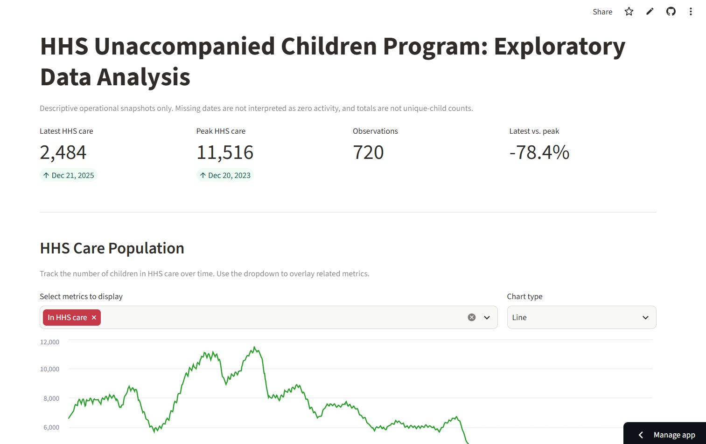
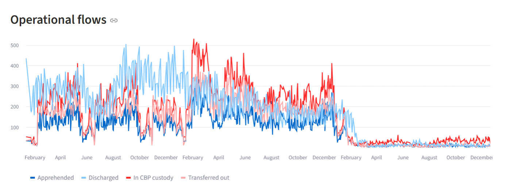
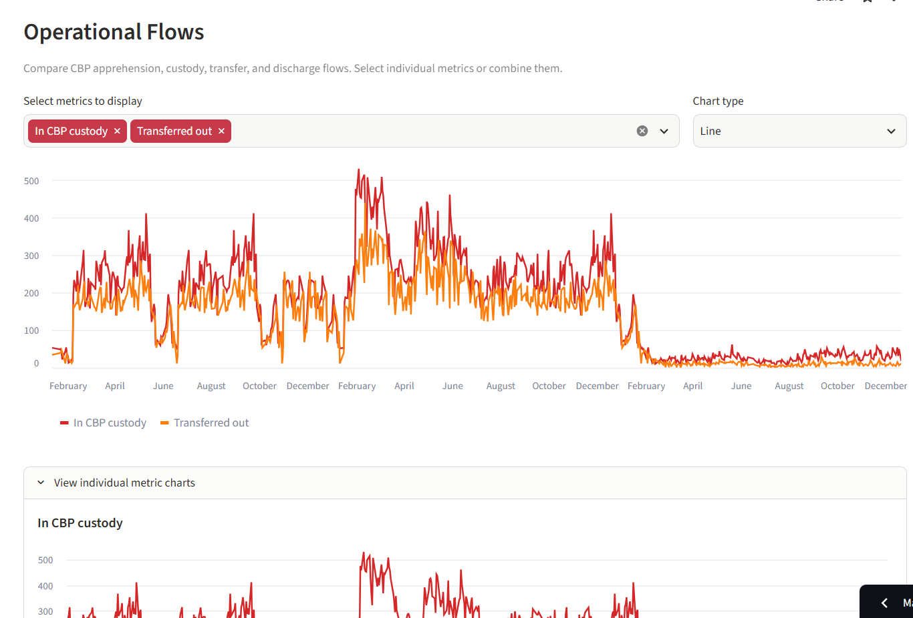
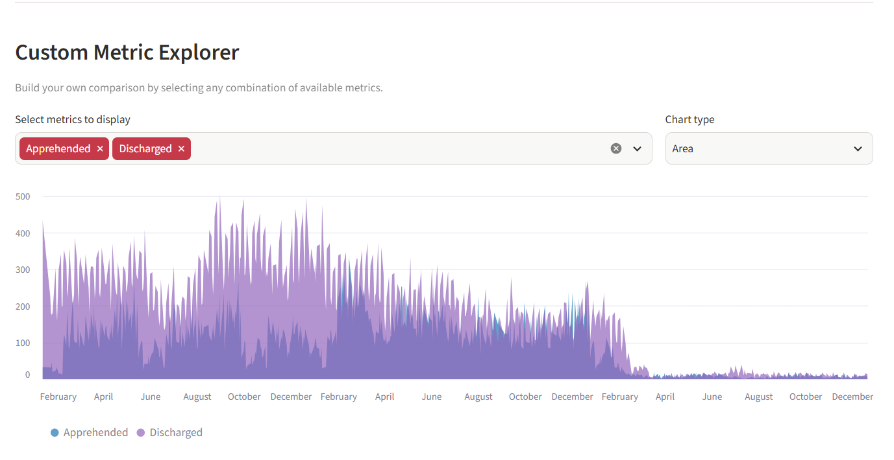
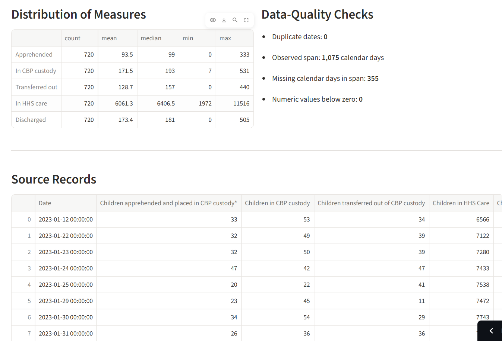

# HHS Unaccompanied Children Program Dashboard

An interactive Streamlit dashboard for exploring the public **HHS Unaccompanied Children Program** dataset. It provides KPI cards, filterable time-series charts with dropdown metric selectors, summary statistics, and data-quality checks.

---

## Features

- **KPI Cards** — Latest HHS care count, peak count, observation count, and latest-vs-peak percentage at a glance.
- **Dropdown Metric Selectors** — Every chart section includes a multiselect dropdown so you can isolate or combine individual metrics instead of viewing them all at once.
- **Chart Type Toggle** — Switch between Line, Area, and Bar chart styles per section.
- **Individual Sparklines** — Expand to see each selected metric on its own mini-chart for clear comparison.
- **Custom Metric Explorer** — Build your own ad-hoc comparison by picking any combination of the five available measures.
- **Date Range Filtering** — Sidebar date picker to focus on a specific time window.
- **CSV Upload** — Bring your own updated export with the same column structure.
- **Data-Quality Panel** — Duplicate dates, missing days, and negative-value checks.
- **Source Record Table** — Browse the full filtered dataset.

---

## Quick Start

### Prerequisites

- Python 3.10+
- pip

### Installation

```bash
# Clone the repository
git clone <repo-url>
cd HHS

# Install dependencies
pip install -r requirements.txt
```

### Run the Streamlit App

```bash
streamlit run app.py
```

The app reads `data/HHS_Unaccompanied_Alien_Children_Program.csv` when present. If the file is missing, upload a compatible CSV from the sidebar.

### Run the Static Dashboard (index.html)

Because browsers block `fetch()` for local files, serve the folder with any static server:

```bash
python -m http.server 8000
```

Open `http://localhost:8000` in a browser. Use **Load another CSV** to explore an updated export with the same columns.

---

## Screenshots

### KPI Cards & HHS Care Population
The top of the dashboard shows four key metrics at a glance, followed by the HHS care population chart with a dropdown to select which metrics to display.



### Operational Flows — Before (All Overlapping)
Previously, all four operational flow metrics were plotted on one chart, making it difficult to distinguish between them.



### Operational Flows — After (With Dropdown Selector)
Now each section includes a **multiselect dropdown** to pick specific metrics and a **chart type toggle** (Line / Area / Bar). You can also expand the **individual metric charts** section to view each metric in isolation.



### Custom Metric Explorer
Build your own comparison by selecting any combination of the five available measures from the dropdown.



### Distribution & Data Quality
Summary statistics and data-quality checks side by side.



> [!NOTE]
> To add your own screenshots, run the app and capture images into the `screenshots/` folder with the filenames shown above.

---

## Included Views

| Section | Description |
|---|---|
| **HHS Care Population** | Children currently in HHS care over time |
| **Operational Flows** | Apprehended, In CBP custody, Transferred out, Discharged |
| **Custom Metric Explorer** | Ad-hoc comparison of any metrics |
| **Distribution of Measures** | Count, mean, median, min, max for every measure |
| **Data-Quality Checks** | Duplicate dates, missing days, negative values |
| **Source Records** | Filterable raw data table |

---

## Research Deliverables

- [Research paper: EDA, insights, recommendations](./RESEARCH_PAPER.md)
- [Executive summary for government stakeholders](./EXECUTIVE_SUMMARY.md)
- [Colab-compatible EDA notebook](./EDA_HHS_Unaccompanied_Children.ipynb)

---

## Project Structure

```
HHS/
├── app.py                                  # Streamlit dashboard
├── index.html                              # Static HTML dashboard
├── styles.css                              # Styles for static dashboard
├── requirements.txt                        # Python dependencies
├── README.md                               # This file
├── RESEARCH_PAPER.md                       # Full research paper
├── EXECUTIVE_SUMMARY.md                    # Executive summary
├── EDA_HHS_Unaccompanied_Children.ipynb    # Jupyter/Colab notebook
├── LICENSE
├── data/
│   └── HHS_Unaccompanied_Alien_Children_Program.csv
└── screenshots/                            # Dashboard screenshots
    ├── kpi_and_care.png
    ├── operational_flows_before.png
    ├── operational_flows_after.png
    ├── custom_explorer.png
    └── distribution_quality.png
```

---

## Tech Stack

- **[Streamlit](https://streamlit.io/)** — Interactive Python dashboard framework
- **[Pandas](https://pandas.pydata.org/)** — Data manipulation and analysis
- **[Matplotlib](https://matplotlib.org/) / [Seaborn](https://seaborn.pydata.org/)** — Used in the Jupyter notebook

---

## License

See [LICENSE](./LICENSE) for details.

Source: [HHS.gov](https://www.hhs.gov/).
